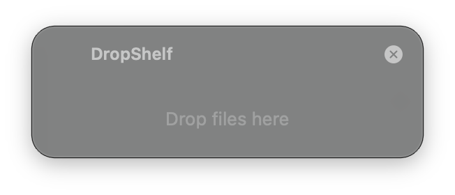
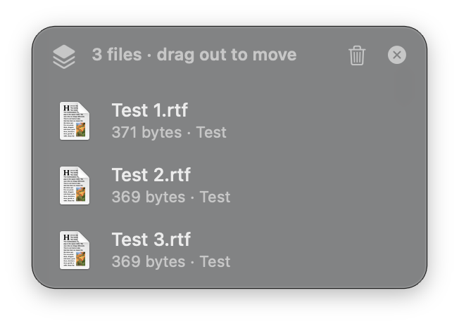

# DropShelf

A free, tiny Dropover-style shelf for macOS. Drag a file, shake the mouse, and a
floating shelf appears under the pointer. Drop files on it, go find the folder
you want, then drag them back out. Menu bar only, no Dock icon, no subscription.

<p align="center">
  
  &nbsp;&nbsp;
  
</p>
<p align="center"><sub>Shake while dragging → the shelf appears. Drop files on it, then drag them out wherever they need to go.</sub></p>

## Build (one time, about 10 seconds)

1. Install the compiler if you don't have it: open Terminal and run
   `xcode-select --install` (skip if Xcode or the Command Line Tools are already there).
2. In Terminal:

   ```bash
   git clone https://github.com/bl4ck0uc4st/DropShelf.git
   cd DropShelf
   ./build.sh --install          # builds, copies to /Applications, launches
   ```

   (Or download the ZIP from the green **Code** button, unzip, `cd` into it, and run `./build.sh --install`.)

A tray icon appears in the menu bar. Done.

## Use

- **Shake while dragging** one or more files (Finder, Desktop, Mail attachments, etc.) → the shelf pops up under the pointer. Drop them on it.
- **Drag a row out** of the shelf into any folder or app. Files are **moved** when dropped in Finder (hold **Option** while dropping to copy instead). Dragging out removes them from the shelf; the shelf closes when it's empty.
- **Drag everything at once**: drag the stack icon at the top-left of the shelf.
- **Select**: click, Cmd-click, Shift-click, Cmd-A, or the arrow keys. **Space** opens Quick Look, **Return** opens the file, **Delete** removes it from the shelf. Hover a row for its × button; right-click for Open / Quick Look / Reveal in Finder.
- **Hide vs. clear**: × hides the shelf but keeps the files on it (the menu bar icon shows how many are parked there); the trash icon clears it. **Esc** hides it too.
- **Move the shelf**: drag any empty part of it.
- If you shake but drop nothing, the shelf disappears on its own.
- Menu bar icon: show the shelf, shake sensitivity, appearance (match system / light / dark), keep files after dragging out, launch at login, quit.

The shelf is a translucent panel that follows your light/dark mode and accent color, like a native macOS popover.

## Troubleshooting

- **Shake does nothing**: try Shake Sensitivity → High, or shake faster (4 quick left-right swings within under a second). If it still doesn't trigger, add DropShelf under System Settings → Privacy & Security → Accessibility (some macOS versions require it for watching mouse drags from other apps).
- **"DropShelf can't be opened"**: you built it locally so Gatekeeper normally allows it. If it complains, right-click the app → Open.
- **Rebuild after changing the code**: run `./build.sh --install` again.
